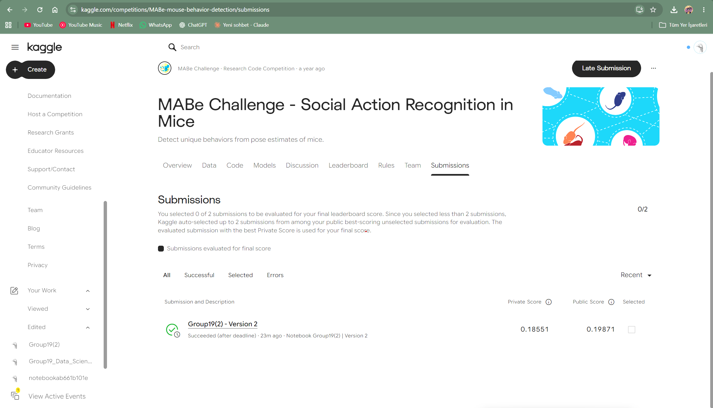

# Kaggle score evidence

# Kaggle Score Evidence

The GROUP19 Assignment 1 notebook was successfully evaluated
on the MABe Challenge as a late submission.

| Submission             | Public Score | Private Score | Status                     |
|------------------------|-------------:|--------------:|----------------------------|
| Group19(2) - Version 2 |      0.19871 |       0.18551 | Succeeded (after deadline) |

## Official Score Screenshot

